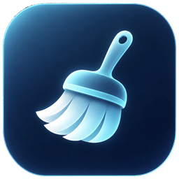

<p align="center"></p>

# Hush

**A little cleanup. A happier PC.** 🩵

Hush is a free, simple cleaning app for Windows 11. It helps you find and remove unnecessary files that build up over time, freeing up storage space and keeping your computer tidy.

No complicated settings. No confusing menus. Just a clean, calm experience.

##  What can Hush do?

- **Free up space** — Find old temporary files, caches, and other things you no longer need.
- **Keep you in control** — See what Hush finds and choose what to remove.
- **Clean with care** — Files are checked before removal, with extra warnings for sensitive items.
- **Adjust Windows settings** — Review and manage supported privacy options.
- **Feel right at home** — Enjoy a soft, modern design with light and dark themes.

##  How does it work?

1. **Scan** — Let Hush look for unnecessary files.
2. **Review** — See what's taking up space and choose what to clean.
3. **Clean** — Remove your selected files and enjoy the extra room!

That's it. Nice and simple.

## Free, private, and peaceful

Hush is completely free, with no ads, no accounts, and no tracking. Your cleanup information stays on your computer.

## 📥 Download Hush

**Latest version: https://github.com/ShepherdGal/Hush/releases/latest.** You only need one of these (each is a zip with one program inside):

| I want to... | Download | What it is |
| --- | --- | --- |
| Just run it, nothing installed | **[Hush-Portable.zip](https://github.com/ShepherdGal/Hush/releases/latest/download/Hush-Portable.zip)** | Unzip it anywhere you can write to (for example `D:\Hush\`), run `Hush-Portable.exe` and make a shortcut to it. |
| Install it like a normal app | **[Hush-Setup.zip](https://github.com/ShepherdGal/Hush/releases/latest/download/Hush-Setup.zip)** | Unzip it and run `Hush-Setup.exe`. For your account only, no administrator rights. Adds a Start menu entry, an optional desktop shortcut and a Settings > Apps entry. |

*Requires Windows 10 or 11 (64-bit); nothing else needs to be installed. Windows may display a warning because the app is not digitally signed: choose **More info > Run anyway**. Both versions update themselves from inside the app (click **Hush** > **Check for updates**). Each zip also holds the terms of use and the MIT license.*

## Use at your own risk

Hush comes without warranty and is used entirely at your own risk; the author is not responsible for any loss of data or settings or any other damage. Hush shows you what it found and asks before it acts, but you decide what to remove, and some changes cannot be undone, so keep backups of anything you care about. The full wording is the **Terms of use** in the app (About > Terms of use) and in [docs/TERMS.md](docs/TERMS.md). This is not legal advice.

## License

Hush is free and open source under the [MIT License](LICENSE) (copyright 2026 ShepherdGal): you may use, copy, modify and share it, and it comes without warranty (see also the [terms of use](docs/TERMS.md)).

## Project layout

For developers: read [CLAUDE.md](CLAUDE.md), [docs/DESIGN.md](docs/DESIGN.md) and [docs/HANDOFF.md](docs/HANDOFF.md) first.

```
src/Hush/           the app: Cleaning/, Updates/, Setup/, WindowsSettings/, UI/, Assets/
tests/Hush.Tests/   verification runner and fixtures-only checks
docs/               design system, handoff, changelog, releasing, Windows settings, terms
scripts/            Build.ps1, Verify.ps1, Backup.ps1, Tidy.ps1
Hush.sln            opens the app and its tests together
```

```powershell
.\scripts\Verify.ps1          # Safety, updater and WPF checks
.\scripts\Build.ps1           # artifacts\: Hush-Portable.zip and Hush-Setup.zip (the uploads) plus the unzipped exes
```

---

Made with care, to make Windows a little less cluttered. 
